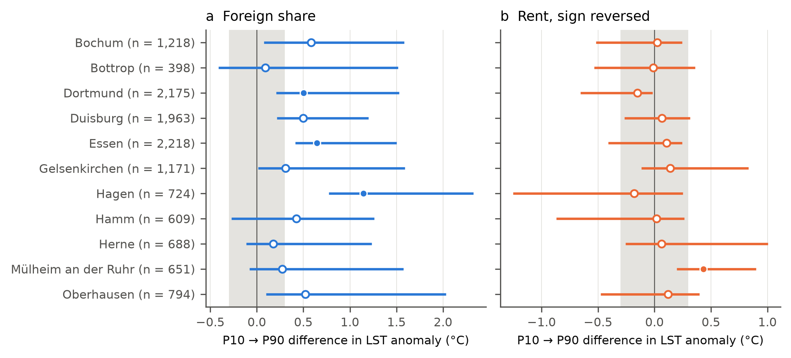

# Where is the surface hotter? Rent, foreign citizens and summer heat on the 100 m census grid of the Ruhr, Germany

**Maria Boudjelal**
Independent researcher, Algiers, Algeria. ORCID: https://orcid.org/0009-0002-6434-784X

**Preregistration:** https://doi.org/10.17605/OSF.IO/CMXS2 (registered 2 November 2026, before any census or temperature value was opened).

## Abstract

**Background.** US studies found hotter surfaces in poorer neighbourhoods; a German 1 km study found foreign citizens in hotter areas, with mixed results for rent. To my knowledge, no study has tested this with a regression on a 100 m census grid.

**Methods.** I joined the Zensus 2022 100 m grid with a daytime land surface temperature (LST) composite from 16 hot-day Landsat scenes (2018 to 2025) in the 11 independent cities of the Ruhr, for rent per m² and the shares of foreign citizens, of residents aged 65+ and under 18. The preregistered model is a spatial error model with city fixed effects, elevation and log population, on the 12,609 cells with all four census values (24.5% of the cells, 44% of the residents; denser and hotter than average). Three inference methods must agree.

**Results.** Between cells at the 10th and the 90th percentile of the foreign share (0% and 45.1%), the adjusted difference was 0.48 °C (95% interval 0.38 to 1.17), and as low as 0.31 °C with other estimates of the spatial dependence (not covered by the interval). It held in all pooled sensitivity analyses and was positive in all 11 cities, significant in 3. For rent and age, the models disagree: inconclusive. The estimated foreign residents lived in cells 0.88 °C hotter than other residents (0.50 °C on the primary-model cells); in the spatial model, at equal density and elevation, the 0.50 °C gap was 0.10 to 0.16 °C, probably an underestimate, most of the drop coming when density was added. Modelled air temperature (1 km, exploratory) showed a practically negligible difference by day, when it varies little inside cities, and a positive one at night.

**Conclusion.** In the denser part of the Ruhr, daytime surface heat goes with where foreign citizens live more clearly than with rent or age. The results describe cells, not people, and surface temperature, not the air or indoor temperature people live with.

**Keywords:** urban heat; environmental justice; land surface temperature; Zensus 2022; spatial error model; Ruhr

## 1. Introduction

Inside a city, summer heat is uneven: a sealed square full of asphalt and roofs can be several degrees hotter at the surface than a park a few hundred metres away. If the people who live in the hottest blocks are also the people with the fewest means to cool their homes or leave the city, heat becomes a question of justice as well as of climate.

Studies from the United States found that poorer neighbourhoods are hotter in most of the cities they looked at (Chakraborty et al., 2019; Hsu et al., 2021). In Germany, Chawla, Keller and Benz (2026) compared 1 km cells within districts with MODIS surface temperature and air temperature: foreigners lived in hotter areas, with significant disparities for both measures in more than half of the cities, while rent per resident gave mixed patterns. König (2024) found that non-nationals in German cities live closer to industrial air pollution and further from green space, with no inequality by socio-economic status, and pointed to housing-market discrimination as a potentially important driver. Recent work has started to use the 100 m census grid: Friesen et al. (2026) found residents of foreign nationality over-represented where access to cool spots is poor in about 60% of Bavarian cities, and Kühnl et al. (2026) modelled heat-wave air temperature at 100 m from citizen-science measurements, land cover and LST, and combined it with census age data for Hamm (one of the cities studied here), Augsburg and Zwickau.

In the Ruhr, the old coal and steel region where I chose to look, Klopfer and Pfeiffer (2023) correlated one Landsat scene from 2018 with the share of non-German residents in 275 districts of eight cities. They called the result ambiguous: the correlation was significant in five cities and not in three. The state environment agency maps where sensitive groups live on top of modelled heat (LANUK, 2026), and Anderson and Hasler (2026), who built a heat risk index for the districts of Bochum, wrote that future studies could compare district results with 100 m census grids.

Here I test the question with a preregistered regression on the 100 m grid of all 11 independent cities, many summer scenes and a spatial model. A 100 m census cell separates a block of flats from the park next to it. The thermal sensor records at 100 m, but its signal spreads into the neighbouring cells, so the results are about city blocks and their immediate surroundings. I ask three questions, fixed before any data were opened:

- **RQ1.** Is summer daytime land surface temperature higher in cells with lower rent (H1) and with a higher share of foreign citizens (H2)?
- **RQ2.** Is it related to the shares of residents aged 65 and over and under 18 (no direction predicted)?
- **RQ3.** How much do the associations of RQ1 change when tree cover and sealed surfaces are taken into account (H3: they move toward zero)?

All three are questions about places. None of them is a causal question, and none describes individual people.

## 2. Data and methods

### 2.1 Study area and design

The study area is the 11 independent cities (kreisfreie Städte) of the Regionalverband Ruhr: Bochum, Bottrop, Dortmund, Duisburg, Essen, Gelsenkirchen, Hagen, Hamm, Herne, Mülheim an der Ruhr and Oberhausen. The design is cross-sectional and ecological: the unit is one inhabited 100 m cell of the INSPIRE grid (EPSG:3035), in which the models are fitted. The analysis plan, including every sensitivity analysis, was registered on OSF on 2 November 2026 (van den Akker et al., 2021, template). Changes made later are listed in Section 2.8. The report follows STROBE for cross-sectional studies (von Elm et al., 2007) with the spatial items of ISLE-ReSt (Jia et al., 2020).

### 2.2 Cells and sample

A cell was included if (1) its centre lies in one of the 11 cities (BKG VG250 boundaries), (2) it has at least 10 residents, (3) less than half of its area is permanent water (ESA WorldCover 2021, class 80), and (4) at least 70% of its area is covered by the heat composite. Of 61,458 inhabited cells, 9,739 had fewer than 10 residents, 8 were mostly water and 302 lacked heat data, leaving **51,409 cells** with 3,241,368 residents. In addition, each model uses only the cells where its census variables are present and not marked as uncertain. For the primary model this means all four census values: **12,609 cells** with 1,416,492 residents.

This sample is not a random part of the Ruhr. It holds 24.5% of the cells but 44% of the residents, because small cells often have a suppressed or uncertain value. Its cells have more residents (median 104 against 50), are more sealed (median imperviousness 57% against 47%) and are hotter (population-weighted mean anomaly 3.6 °C against 2.9 °C) than all included cells. The results of the primary model are therefore about the denser part of the Ruhr.

### 2.3 Surface heat

I used Landsat 8 and 9 Collection 2 Level 2 surface temperature (USGS, LSDS-1619; Cook et al., 2014), produced by USGS with emissivity from the ASTER Global Emissivity Database, from Google Earth Engine: paths 196 and 197, row 24, June to August 2018 to 2025. Of 115 candidate scenes, 51 were taken on hot days (daily maximum air temperature of at least 25 °C at the DWD station Essen-Bredeney), and 16 of these had at least 80% valid pixels in a fixed core area of the 11 cities. A pixel was invalid if flagged as fill, cloud (including dilated and medium-confidence cloud), cloud shadow, cirrus or snow, if its temperature was outside the valid range, or if it lay less than 1 km from a cloud. The 16 scenes (9 Landsat 8, 7 Landsat 9; 8 from path 196 and 8 from path 197; 9 from June) are listed in Supplementary Table S0. There is no usable hot-day scene from 2020 or from 2022, the census year. The images were taken at about 10:21 (path 196) and 10:27 (path 197) UTC, which is about 10:50 local solar time: late morning, before the daily peak of surface temperature.

Hot days differ in overall temperature: the median surface temperature of the core area ranged from 30.0 to 40.1 °C across the scenes. To compare places and not days, I subtracted from each pixel the median of the valid core pixels of the same scene. This **LST anomaly** says how much warmer or cooler a place is than the middle of the 11 cities on that day. The composite is the mean anomaly of each 30 m pixel over the scenes in which it was valid (at least 5 observations). The value of a cell is the mean of the composite inside it, weighted by exact pixel overlap (exactextract), computed in the native Landsat grid (EPSG:32632) with the cells reprojected as polygons. The Landsat thermal band is recorded at 100 m and delivered at 30 m, so a cell's value contains some signal from its neighbours. The median uncertainty reported by USGS for the retained pixels (ST_QA) was 2.21 K, and 7.7% exceeded 3 K (sensitivity S16 masks them). 223 included cells were seen only from one orbit path and 270 partly (21 of them in the primary sample). As a comparison with an independent source, the composite agrees with the modelled day map of the state agency (LANUK, 2026), a model driven by land use, with a pixel-level Spearman correlation of 0.64.

### 2.4 Census variables

From the Zensus 2022 (reference day 15 May 2022, published by Destatis on the 100 m grid) I used the average net cold rent per m² of rented dwellings, the share of foreign citizens, the share aged 65 and over and the share aged under 18. **Foreign citizens** (Ausländer) are residents without German nationality; people with German and another nationality count as German. This is a legal status, not migration background, which the grid data do not report, and it groups very different people, from long-settled families to recent arrivals. The **estimated number of foreign residents** of a cell is its share times its population, and the "other residents" are the rest. Rent per m² measures the price of housing, not household income: a low value can mean social housing or old buildings. Shares enter the models per 10 percentage points and rent per 1 EUR/m². The census marks some values in brackets (uncertain) and perturbs small counts for confidentiality (Cell-Key Method). Bracketed values are treated as missing in the primary analysis (sensitivity S1 includes them). A dash means "zero, or changed to zero" and is read as 0 (an exploratory analysis treats it as missing). Rent exists only where rented dwellings exist, so its absence is not random.

### 2.5 Covariates

All models include elevation (mean of the Geobasis NRW terrain model in the cell; higher ground is cooler and the Ruhr rises to the south), the natural log of the number of residents (density) and 10 city dummies, so that every comparison is within a city. Model B adds tree cover (Copernicus Tree Cover Density, 2022) and imperviousness (Copernicus Imperviousness Density, 2021), as % of the cell. The data do not cover the same moment: census 2022, land cover 2021 and 2022, heat 2018 to 2025.

### 2.6 Models and inference

**Model A** regresses the cell LST anomaly on the four census variables, elevation, log population and the city dummies. Neighbouring cells share influences that are not in the model (a wind corridor, a large building, and the blur of the thermal sensor), so their errors are not independent. In ordinary least squares (OLS), the residuals were strongly clustered (Moran's I 0.66), and the robust Lagrange multiplier tests (tests on the OLS residuals that compare an error model with a lag model) favoured an error model (789 against 450). The primary estimator is therefore a **spatial error model**, u = λWu + ε: the error of a cell u is partly the average error of its neighbours (Wu, weighted by λ) and partly its own (ε). It is estimated by GMM, a method that does not assume normal errors, with standard errors that allow the error spread to differ between cells (Arraiz et al., 2010; spreg). W gives equal weight to each included cell that touches the cell (by an edge or a corner); 1,712 cells (13.6%) have no included neighbour.

Because each method has its own weak point, the preregistered rule combines three: two GMM fits (Drukker et al., 2013), one allowing and one not allowing the error spread to differ between cells, and an OLS bootstrap that resamples whole 1 km blocks within each city (1,189 blocks, 999 replicates). For each variable, the largest of the three p-values is corrected for four tests with the Holm method, and the reported 95% interval is the hull of the three intervals (the smallest range that covers all three). Because the bootstrap interval is centred on the OLS estimate, the hull is often lopsided around the spatial estimate; it is deliberately wide. A hypothesis is supported only if the Holm-adjusted p is below .05 and all three intervals lie on the expected side of zero. Effects are reported as the expected difference between cells at the 10th and the 90th percentile of each variable (P10 to P90), with the sign of rent reversed so that a positive value always means "hotter where the disadvantage is". An effect whose whole interval lies within ±0.3 °C is called practically negligible; this threshold is a judgement fixed in advance. Variance inflation factors were all below 1.8.

The preregistration also asks for **single-variable models**: each census variable alone, adjusted only for elevation, log population and city, on its own usable cells. They describe the pattern before the census variables are adjusted for each other.

**H3** compares the OLS coefficients of rent and of the foreign share between Model A and Model B on the same cells: Δ* = sign(β_A) × (β_A − β_B), positive when the coefficient moves toward zero, with a one-sided block-bootstrap test and a Holm correction for two tests. This is a change in estimate, not a mediation effect: tree cover and sealing can be causes, consequences or companions of where people live.

### 2.7 Sensitivity and local analyses

The preregistration lists 20 sensitivity analyses (S1 to S20), all reported in Supplementary Table S1. Grouped by the threat they address, they change: the census handling (S1 uncertain values included, S2 rent left out, S11 other population thresholds); the weighting (S3, by population); the heat measure (S4 hot-day rule relaxed, which adds one scene; S5 absolute temperature; S6 and S6b one satellite or one orbit path; S12 to S16 other scene and pixel rules); the scale (S7, 1 km grid); the spatial model (S8 lag model, S9 nearest-neighbour weights, S18 spatial Durbin error model, S20 cells without neighbours dropped); the bootstrap blocks (S19); the land-cover covariates (S17, a 300 m window; this changes Model B only, so for Model A it repeats the primary result); and the city (S10, each city alone). The heat-measure checks reuse the same satellite and largely the same scenes, so they test processing choices, not the sensor. To see where relationships differ inside the region, I fitted a multiscale geographically weighted regression (MGWR; Fotheringham et al., 2017; Oshan et al., 2019) of Model B on the 1 km grid (742 cells), as a descriptive tool.

### 2.8 Deviations from the preregistration and checks

Eighteen deviations are listed with their dates and reasons in the repository (`00_protocol/deviations.md`). The ones that touch results are: S3 was fitted by population-weighted OLS with the block bootstrap, because the GMM estimators offer no weights (D9); the MGWR bandwidth search was started at 20 instead of 42 neighbours so that the optimum could be reached (D15); S7 effects are also shown with 1 km percentiles (D13); the share of permanent water had to be computed for small cells before S11 could run (D12). The planned comparison with ECOSTRESS afternoon temperature was not done (D16). Two exploratory checks were added after an internal check of this article and written down before they were run: the same analysis with air temperature by day and by night (D17), and with the regressors smoothed to the scale of the thermal sensor (D18). Every key number was computed a second time by separate code: the cell values in R (exactextractr) and Python, the spatial error models by writing out the two-step GMM by hand in R, and MGWR with GWmodel in R. This reproduced the coefficients within 0.0001 standard errors and the standard errors to the reported precision. The plan and every check are in the public repository.

### 2.9 Use of AI tools

[USE OF AI TOOLS: written in the submitted version.]

## 3. Results

### 3.1 Heat and population across the Ruhr

Among the included cells, surface heat is strongly clustered (Figure 1a; Moran's I 0.75). The share of foreign citizens is also clustered (Moran's I 0.61; Figure 1b). Rent (0.41) and the age shares (0.23 and 0.22) are less clustered. Without any model, the estimated foreign residents lived in cells with a mean anomaly of 3.8 °C and the other residents in cells with 2.9 °C (all 34,940 cells with a usable foreign share, pooled across cities).

### 3.2 Main results

Table 1 gives the primary results. A higher share of foreign citizens went with a hotter surface: 0.106 °C per 10 percentage points, so 0.48 °C between the 10th and the 90th percentile (95% interval 0.38 to 1.17; Holm-adjusted p = .008). **H2 is supported.** For rent the effect was 0.04 °C (−0.32 to 0.10), and the age shares were close to zero too: **H1 and RQ2 are inconclusive.** As Section 3.3 shows, this is because the methods disagree, not because all of them find nothing.

**Table 1.** Model A, spatial error model (12,609 cells). β per unit (rent: 1 EUR/m²; shares: 10 percentage points), with the hull of the three 95% intervals and the Holm-adjusted p. Effect: expected difference in LST anomaly between cells at P10 and P90 (rent: P90 to P10, so that positive means hotter where rent is low). With other estimates of λ (see below), the foreign-share effect was 0.35 and 0.31 °C, below this interval: the interval does not include the uncertainty about λ.

| Variable | P10 to P90 | β (95% interval) | p (Holm) | Effect, °C (95% interval) | Verdict |
|----------------|--------------|------------------------|-------|----------------------|------------------|
| Rent (EUR/m²) | 5.05 to 7.24 | −0.016 (−0.045 to 0.147) | .759 | 0.04 (−0.32 to 0.10) | H1: inconclusive |
| Foreign citizens (%) | 0.0 to 45.1 | 0.106 (0.084 to 0.259) | .008 | 0.48 (0.38 to 1.17) | H2: supported |
| Aged 65+ (%) | 8.4 to 35.7 | −0.001 (−0.114 to 0.024) | .909 | 0.00 (−0.31 to 0.07) | inconclusive |
| Under 18 (%) | 0.0 to 28.8 | −0.019 (−0.332 to 0.014) | .759 | −0.06 (−0.96 to 0.04) | inconclusive |

Two things in Table 1 need care. First, OLS and the spatial model disagree: all four OLS coefficients (rent 0.091, foreign share 0.216, 65+ −0.074, under 18 −0.274) lie outside the spatial model's own 95% interval (not the hull of Table 1, which includes the OLS bootstrap interval); they are larger in size for every variable, and for rent the sign is the opposite. This pattern is usually read as a sign that the model leaves something out (Pace and LeSage, 2008); I did not run a formal test, so the comparison is descriptive. The quantity being estimated depends on the estimator, and neither set of coefficients is simply "correct". Second, the coefficients are computed at a first estimate of λ. The λ that the software reports (0.78) comes from a later step, and at that value the foreign-share effect is 0.35 °C; iterated to convergence (λ = 0.82), it is 0.31 °C. I therefore read the adjusted foreign-share effect as about 0.31 to 0.48 °C.

The single-variable models give the same picture for the foreign share once the sample is the same. On all 34,940 cells with a usable foreign share, its single-variable effect was small (0.14 °C, 0.09 to 0.20, within ±0.3 °C). On the 12,609 primary-model cells it was 0.45 °C, close to the adjusted 0.48 °C: adding rent and the age shares barely changes it in the spatial model (in OLS it moves from 0.78 to 0.97 °C). The difference between 0.14 and 0.48 °C therefore comes from the sample, the denser cells, and not from the adjustment. Elevation and log population, which are in both models, already take out about half of the raw gradient (Section 3.5).

### 3.3 Robustness, and where the methods disagree

The foreign-share association held in every pooled preregistered sensitivity analysis with a verdict: it was supported in the primary model, in all 20 distinct preregistered sensitivity fits with a verdict (S6b and S11 each have two versions), in S17, which repeats the primary model by construction, and in the exploratory one, with effects in °C from 0.19 to 1.01 (S15 is on a standardised scale). The smallest effects came from including uncertain values (S1), from nearest-neighbour weights (S9) and from dropping cells without neighbours (S20, 0.28 °C). The largest came from weighting by population (S3, 1.01 °C), which gives the dense cells more weight. The spatial lag model (S8) gave a total effect of 0.85 °C with an interval above zero. On the 1 km grid (S7, 742 cells) it was also supported; with 1 km percentiles it is 0.53 °C.

![P10 to P90 differences in LST anomaly and their 95% intervals, primary model and sensitivity analyses in °C. Filled: Holm-adjusted p < .05 with the whole interval on one side of zero. Grey band: ±0.3 °C (practically negligible). Rent with its sign reversed: positive means hotter where rent is low. S17 changes Model B only, so for Model A it repeats the primary result. Last row: exploratory analysis with census dashes treated as missing. S7 (1 km), S8 (lag model), S10 (single cities) and S15 (standardised scale) are in Table 2, Figure 3 and Supplementary Table S1.](../05_analysis/results/figures/fig2_effects.png)

For rent and the age shares, the methods disagree (Table 2). The spatial error model finds almost nothing. The analyses that compare cells across whole neighbourhoods find the opposite of H1 for rent, hotter where rent is high: OLS, population weights (S3, "contradicted"), the lag model (S8: −0.24 °C, −0.33 to −0.14), the 1 km grid (S7: −0.46 °C, interval crossing zero) and the cell plus its neighbours in S18 (−0.24 °C, −0.36 to −0.13). They also find cooler cells where more older people and more children live (S7: −0.70 and −1.95 °C; S8: −0.18 and −0.67 °C). City by city, rent supported H1 only in Mülheim an der Ruhr (0.43 °C, 0.20 to 0.90); in Dortmund the interval lay on the other side (−0.15 °C, −0.65 to −0.02), though not significant after Holm. As Chawla et al. (2026) note, high rents can mark cool green areas as well as hot central ones, so a single straight line may not capture rent. None of this supports H1.

**Table 2.** Where the methods disagree: P10 to P90 effects in °C with 95% intervals (rent with its sign reversed: positive means hotter where rent is low). OLS: the coefficient with its block-bootstrap interval. S18: the cell plus the average of its neighbours, descriptive; the preregistered S18 verdict uses the cell alone (0.54 °C for the foreign share; Supplementary Table S1).

| Analysis | Rent (sign reversed) | Aged 65+ | Under 18 | Foreign citizens |
|---|---|---|---|---|
| Primary: spatial error model (reported hull) | 0.04 (−0.32 to 0.10) | 0.00 (−0.31 to 0.07) | −0.06 (−0.96 to 0.04) | 0.48 (0.38 to 1.17) |
| OLS, block bootstrap 95% interval | −0.20 (−0.32 to −0.07) | −0.20 (−0.31 to −0.09) | −0.79 (−0.96 to −0.58) | 0.97 (0.74 to 1.17) |
| S3 population-weighted OLS | −0.45 (−0.62 to −0.29) | −0.59 (−0.73 to −0.43) | −1.46 (−1.66 to −1.21) | 1.01 (0.76 to 1.23) |
| S7 1 km grid (100 m percentiles) | −0.46 (−0.93 to 0.13) | −0.70 (−1.21 to −0.23) | −1.95 (−2.92 to −1.24) | 0.80 (0.27 to 1.45) |
| S8 spatial lag model, total effect | −0.24 (−0.33 to −0.14) | −0.18 (−0.29 to −0.07) | −0.67 (−0.84 to −0.49) | 0.85 (0.72 to 0.99) |
| S18 own cell plus neighbours (β + θ), descriptive | −0.24 (−0.36 to −0.13) | −0.07 (−0.27 to 0.12) | −0.18 (−0.46 to 0.11) | 1.38 (1.14 to 1.63) |

City by city (S10, Figure 3), the foreign-share association was positive in all 11 cities and significant in 3 (Dortmund, Essen and Hagen). The single cities have between 398 and 2,218 cells, so wide intervals are expected.

### 3.4 Tree cover and sealed surfaces (H3)

Adding tree cover and imperviousness changed both OLS coefficients in the direction of H3: Δ* = 0.124 (95% interval 0.083 to 0.162) for rent and 0.075 (0.037 to 0.106) for the foreign share, both with Holm-adjusted p = .002. **H3 is supported for the OLS estimate.** For the foreign share, about a third of the OLS coefficient (35%) goes with tree cover and sealing; for rent, the coefficient crossed zero (from 0.091 to −0.033), so a share is not meaningful. In the spatial error model the picture is different: with its own sign, Δ* is −0.015 for the foreign share, so its coefficient did not move toward zero; for rent (−0.028) the direction is unclear, because its spatial coefficient is indistinguishable from zero. Because neighbouring cells share thermal signal, this within-neighbourhood comparison is close to what the sensor can resolve (Section 3.7).

### 3.5 From cells to residents

The P10 to P90 effect compares two cells far apart on the foreign share (0% and 45.1%). Residents are spread over many cells: on the primary-model cells, the average foreign resident lives in a cell with 37.8% foreign citizens and the average other resident in a cell with 22.6%, a gap of 15.2 points. The mean anomaly of the cells where the estimated foreign residents live was 0.50 °C higher than that of the other residents (0.48 °C when compared within each city; a different quantity from the 0.48 °C cell contrast). On all 34,940 cells with a usable foreign share, the observed gap is larger, 0.88 °C: that sample adds many small cells, which are cooler on average (Section 2.2).

By construction, the observed gap equals the population-weighted slope of heat on the foreign share times the 15.2-point gap (Figure 4). Adding the city changes it little; adding elevation and log population more than halves it, about 81% of that drop through log population (density). Adding rent and the age shares raises it slightly in OLS, and the spatial model brings it down to 0.16 °C (0.10 °C at the iterated λ). These spatial values are probably too low: when the regressors are smoothed to the scale of the thermal signal (Section 3.7), the spatial coefficient roughly doubles (from 0.106 to 0.224 per 10 points), and with the smaller exposure gap of the smoothed share (11.3 points) the implied gap is about 0.25 °C.

Which of these numbers describes the disparity depends on what one holds fixed. The observed 0.88 °C and 0.50 °C are what the two groups live with, as far as daytime surface heat goes. The smaller numbers compare residents at equal density and elevation, inside the same neighbourhood. Density may be part of how the gap arises (dense, sealed blocks are hot and are where many foreign citizens live), so removing it is not neutral.

### 3.6 Local patterns (MGWR)

On the 1 km grid, MGWR fitted much better than OLS on the same cells (R² 0.88 against 0.81; AICc 741.9 against 901.9). The intercept was very local (bandwidth 30 of 742 neighbours): it captures local heat that the variables do not explain. The foreign share, rent, the under-18 share and log population had bandwidths of 740, the largest reached and close to the upper end of the search (742): their relationship with heat is regional rather than local. The foreign-share coefficient was positive and significant in 100% of the local fits. Imperviousness had the most local relationship among the covariates (bandwidth 167).

### 3.7 Exploratory checks

Two checks were added after an internal check of this article and written down before they were run (deviations D17 and D18). Neither has a preregistered verdict.

**Air temperature by day and by night (D17).** I repeated the 1 km version of Model A (as in S7, 742 cells) with the anomaly of 2 m air temperature from the DWD HOSTRADA grids (Krähenmann et al., 2018) on the same 16 dates: by day at the time of the satellite image (mean of 10:00 and 11:00 UTC) and in the following night (mean of 01:00 and 02:00 UTC). HOSTRADA is not a measurement in each cell: it is interpolated from weather stations with satellite and model data, with special attention to the urban heat island (DWD dataset description), and, as Chawla et al. (2026) describe it, with elevation and land-cover data; so its pattern inside the cities partly reflects these predictors. It is the same product that Chawla et al. (2026) used, so it does not independently confirm their result. Its effective resolution depends on the station density and the predictors (DWD dataset description) and is probably coarser than 1 km, so the intervals below are probably too narrow. Air temperature varies much less between places than surface temperature (standard deviation across the included cells 0.30 °C by day and 1.12 °C at night, against 2.2 °C for the LST anomaly). By day, the foreign-share effect on air temperature was practically negligible (0.02 °C, 0.00 to 0.09), against 0.53 °C for LST on the same 1 km cells; this shows how little this product varies inside the cities by day, not that daytime air exposure is equal. At night the effect was 0.46 °C (0.26 to 1.09) between 1 km cells at the 10th and the 90th percentile of the foreign share, and the shares of older residents (−0.17 °C) and of children (−0.31 °C) went with cooler nights. Without adjustment, the estimated foreign residents lived in cells 0.46 °C warmer at night than other residents (a different quantity from the cell contrast just above, with a similar value; 0.26 °C on the primary-model cells), and 0.08 °C warmer by day.

**Thermal resolution and number of observations (D18).** When the six continuous regressors were replaced by their means over the cell and its eight neighbours (a 300 m window, close to the effective footprint of the thermal signal), the foreign-share effect stayed supported and became larger (0.93 °C, 0.67 to 1.34, with the percentiles of the smoothed share), and the shares of older residents (−0.26 °C) and of children (−0.19 °C) became negative with intervals below zero; rent stayed inconclusive. So the main result does not depend on contrasts finer than the sensor, while the age results depend on the scale. The number of valid observations per cell was almost unrelated to the foreign share, rent and imperviousness (Spearman correlations of about 0.05), and on the 12,124 cells with at least 12 of 16 observations the foreign-share effect was 0.48 °C, as in the primary model.

The vacancy rate of dwellings (an extra census variable, not in the hypotheses) went with a hotter surface (0.16 °C per 10 points, 8,023 cells), but 94% of these cells have no vacancy, so I do not interpret it. The preregistered interaction of rent with tree cover was not significant (p = .148 with errors allowed to differ between cells). Treating census dashes as missing instead of zero left the foreign-share result supported (Supplementary Table S1).

## 4. Discussion

### 4.1 What the results say

In the denser part of the Ruhr covered by the primary model, summer daytime surface heat goes with the share of foreign citizens much more clearly than with rent or age. The foreign-share association survives a conservative inference rule, every pooled sensitivity analysis and the city fixed effects; it is positive in every city, though significant in only 3 of the 11. Its size depends on the estimator: about 0.31 to 0.48 °C between cells at the 10th and the 90th percentile in the spatial model, and about 0.97 °C in OLS. Rent, a common proxy for socio-economic position that measures housing price rather than income, gives no clear answer, and the models that compare whole neighbourhoods even point the other way.

This matches the national pattern of Chawla et al. (2026), who found foreigners in hotter areas in most German cities and called rent "a complex indicator". It also matches König (2024): non-nationals disadvantaged in environmental quality, with no gradient by socio-economic status. Klopfer and Pfeiffer (2023) found a positive correlation with the non-German share in all eight of their cities, significant in five; the pooled within-city model on the 100 m grid, with its adjustment and sensitivity analyses, shows that the pattern is consistent across the region even where single cities are not significant. It differs from the clearer income gradients found in US cities (Chakraborty et al., 2019; Hsu et al., 2021), where the history of segregation and the structure of rents are different.

### 4.2 Why the spatial model and OLS differ

The OLS coefficients are larger in size than the spatial ones for every variable (for the foreign share, 2.0 times as large). OLS compares any two cells of the same city; the spatial error model mainly compares a cell with its own surroundings. Both are legitimate questions, but they are not the same question. The drop suggests that much of the association lies at the scale of whole neighbourhoods. Part of the spatial error is also the blur of the thermal sensor, which spreads heat over neighbouring cells, so I do not read the within-neighbourhood comparison as a fine-grained finding. The H3 result fits this: tree cover and sealing go with part of the gap between neighbourhoods (OLS), not with the smaller gap within them (spatial model).

### 4.3 What it means for planning

In the denser part of the Ruhr covered by the primary model (24.5% of the cells, 44% of the residents), the results show where daytime surface heat and the share of foreign citizens coincide: mostly in dense, sealed parts of the cities. They do not show that greening or unsealing these places would reduce the gap, and surface heat is not the air or indoor temperature people feel. Still, cooling measures in these quarters could reach a disproportionate share of foreign citizens. Such measures can also raise rents and push out the residents they are meant to help; Anguelovski et al. (2019) call this green "climate gentrification". Tenant protection and the participation of the people who live there belong to any such plan. The LANUK maps (2026) show where sensitive groups live under modelled heat; this study adds that, in these denser cells, the gap is measurable and follows the share of foreign citizens. Because the MGWR bandwidths of the foreign share are regional, this is a question for regional as well as city planning.

### 4.4 Limitations

- **Surface, daytime, not air or indoors.** LST measures the surface seen from above in the late morning of clear hot days, mostly roofs and streets. At the scale of whole cities, satellites showed urban heat islands about six times stronger than air temperature from weather stations during the 2019 heat wave in Europe (Venter et al., 2021); the surface heat island exceeded the air heat island in 96% of cities by day and 80% at night. Chawla et al. (2026) found disparities against foreigners most often in night-time air temperature. Section 3.7 adds an exploratory check with interpolated, modelled air temperature, which points the same way at night; indoor heat and housing quality (for example top-floor flats or crowding) are not measured.
- **Cells, not people.** The results describe cells (ecological fallacy). The resident gaps assume that every resident of a cell lives with that cell's mean heat.
- **A selective sample.** The primary model uses 24.5% of the cells and 44% of the residents, the denser and hotter part of the region. Rent is missing where nobody rents.
- **Density as a pathway.** The adjusted effects hold log population fixed. If foreign citizens live in hotter cells partly because they live in denser ones, the adjusted effects understate the disparity they experience; the observed gap (0.88 °C on all usable cells, 0.50 °C on the primary-model cells) is the descriptive disparity.
- **Estimator dependence and resolution.** OLS and the spatial model disagree, and the size of the foreign-share effect depends on the estimated λ, which the intervals do not include. The thermal data are recorded at 100 m and blurred beyond that, so neighbouring cells share signal; the residual correlation also extends beyond 2 km, so the bootstrap intervals may be a little narrow.
- **Time and scale.** Census 2022, land cover 2021 and 2022, heat 2018 to 2025 with no hot-day scene from the census year; 9 of the 16 scenes are from June, and two pairs are on consecutive days. Results can change with the cell size (MAUP; S7 shows the 1 km version).
- **Measurement.** The tree cover of Hamm is unusually low in the Copernicus 2022 layer (median 0.6% of the cell against 3.2 to 8.4% in the other cities); the raster covers the city completely, and I could not tell whether this is real or a product artefact. The city dummies absorb its mean level, but not its effect on the slopes of Model B. Census values are perturbed for confidentiality, which tends to pull coefficients toward zero. Emissivity comes from the ASTER database, so errors are systematic across scenes and can differ between roof materials; neither the anomaly nor the average over scenes removes them.
- **Not causal.** Nothing here says why foreign citizens live in hotter places: housing markets and discrimination are possible (König, 2024), and so, in my own reading of the Ruhr, is the location of former workers' housing near industry; none was measured.

### 4.5 Generalisability

The Ruhr is a polycentric, post-industrial region. The method (a 100 m census grid, a hot-day LST composite, a spatial model and a conservative inference rule) can be applied to any German region with the open code of this study. The size of the gap may not transfer.

## 5. Conclusion

In the denser part of the 11 cities of the Ruhr, the share of foreign citizens is the clearest social marker of daytime surface heat at the scale of city blocks, more than rent or age. Most of this association appears between neighbourhoods rather than within them. Density goes with much of the resident gap, and tree cover and sealing with about a third of the association between neighbourhoods. An exploratory check with interpolated, modelled air temperature at 1 km points the same way at night. These are cell-level results: they show where heat and a social group coincide, not why, and not how hot people's homes are.

## Declarations

**Data and code availability.** All data are open. Code, the analysis table, results, the verification scripts and their logs are in the public repository of this study (link given on publication, archived on OSF). The preregistration is at https://doi.org/10.17605/OSF.IO/CMXS2.

**Data sources and licences.** Zensus 2022: © Statistische Ämter des Bundes und der Länder, Datenlizenz Deutschland Namensnennung 2.0. Landsat 8 and 9: courtesy of the U.S. Geological Survey. Copernicus Land Monitoring Service, European Union (Tree Cover Density, Imperviousness Density). ESA WorldCover 2021 (CC BY 4.0). Elevation: Geobasis NRW (dl-de/zero-2-0). Boundaries: © BKG (dl-de/by-2-0). Weather and air temperature: Deutscher Wetterdienst (HOSTRADA v1.0; Krähenmann et al., 2018). Modelled heat: LANUK NRW.

**Funding.** None.

**Competing interests.** None.

**Acknowledgements.** [ACKNOWLEDGEMENTS: written in the submitted version.]

## References

Anderson, C. C., & Hasler, N. (2026). Urban heat and public green space: Assessing risk, equity, and the lived experiences of residents in Bochum, Germany. *International Journal of Disaster Risk Reduction*, 143, 106299. https://doi.org/10.1016/j.ijdrr.2026.106299

Anguelovski, I., Connolly, J. J. T., Pearsall, H., Shokry, G., Checker, M., Maantay, J., Gould, K., Lewis, T., Maroko, A., & Roberts, J. T. (2019). Why green "climate gentrification" threatens poor and vulnerable populations (Opinion). *Proceedings of the National Academy of Sciences*, 116(52), 26139-26143. https://doi.org/10.1073/pnas.1920490117

Arraiz, I., Drukker, D. M., Kelejian, H. H., & Prucha, I. R. (2010). A spatial Cliff-Ord-type model with heteroskedastic innovations: Small and large sample results. *Journal of Regional Science*, 50(2), 592-614. https://doi.org/10.1111/j.1467-9787.2009.00618.x

Chakraborty, T., Hsu, A., Manya, D., & Sheriff, G. (2019). Disproportionately higher exposure to urban heat in lower-income neighborhoods: A multi-city perspective. *Environmental Research Letters*, 14(10), 105003. https://doi.org/10.1088/1748-9326/ab3b99

Chawla, J., Keller, P., & Benz, S. (2026). Comparing land surface temperature and air temperature for assessing socio-demographic inequalities in urban heat exposure: Evidence from Germany. *Environmental Research Letters*, 21(15), 154033. https://doi.org/10.1088/1748-9326/ae929e

Cook, M., Schott, J., Mandel, J., & Raqueno, N. (2014). Development of an operational calibration methodology for the Landsat thermal data archive and initial testing of the atmospheric compensation component of a land surface temperature (LST) product from the archive. *Remote Sensing*, 6(11), 11244-11266. https://doi.org/10.3390/rs61111244

Drukker, D. M., Egger, P., & Prucha, I. R. (2013). On two-step estimation of a spatial autoregressive model with autoregressive disturbances and endogenous regressors. *Econometric Reviews*, 32(5-6), 686-733. https://doi.org/10.1080/07474938.2013.741020

Fotheringham, A. S., Yang, W., & Kang, W. (2017). Multiscale geographically weighted regression (MGWR). *Annals of the American Association of Geographers*, 107(6), 1247-1265. https://doi.org/10.1080/24694452.2017.1352480

Friesen, J., Heinz, S., Droin, A., Wurm, M., Leichtle, T., Marconcini, M., & Taubenböck, H. (2026). Assessing pedestrian accessibility to urban land surface temperature cold spots in Bavarian cities. *REAL CORP 2026 Proceedings*. https://doi.org/10.48494/REALCORP2026.4148

Hsu, A., Sheriff, G., Chakraborty, T., & Manya, D. (2021). Disproportionate exposure to urban heat island intensity across major US cities. *Nature Communications*, 12, 2721. https://doi.org/10.1038/s41467-021-22799-5

Jia, P., Yu, C., Remais, J. V., Stein, A., Liu, Y., Brownson, R. C., et al. (2020). Spatial Lifecourse Epidemiology Reporting Standards (ISLE-ReSt) statement. *Health & Place*, 61, 102243. https://doi.org/10.1016/j.healthplace.2019.102243

Klopfer, F., & Pfeiffer, A. (2023). Determining spatial disparities and similarities regarding heat exposure, green provision, and social structure of urban areas: A study on the city district level in the Ruhr area, Germany. *Heliyon*, 9(6), e16185. https://doi.org/10.1016/j.heliyon.2023.e16185

König, C. (2024). Neighbourhood structure and environmental quality: A fine-grained analysis of spatial inequalities in urban Germany. *Urban Studies*, 61(10), 1968-1989. https://doi.org/10.1177/00420980231224224

Krähenmann, S., Walter, A., Brienen, S., Imbery, F., & Matzarakis, A. (2018). High-resolution grids of hourly meteorological variables for Germany. *Theoretical and Applied Climatology*, 131, 899-926. https://doi.org/10.1007/s00704-016-2003-7

Kühnl, M., Leichtle, T., Rupp, S., Hiete, M., Beck, C., Geiß, C., & Taubenböck, H. (2026). Identifying vulnerable population under heat stress: A data-driven urban risk assessment using remote sensing, citizen science and census data. *REAL CORP 2026 Proceedings*. https://doi.org/10.48494/realcorp2026.0144

LANUK NRW (2026). *Klimaanalyse NRW 2026: Methoden- und Ergebnisüberblick*. Fachbericht 171. Landesamt für Natur, Umwelt und Klima Nordrhein-Westfalen.

Oshan, T. M., Li, Z., Kang, W., Wolf, L. J., & Fotheringham, A. S. (2019). mgwr: A Python implementation of multiscale geographically weighted regression for investigating process spatial heterogeneity and scale. *ISPRS International Journal of Geo-Information*, 8(6), 269. https://doi.org/10.3390/ijgi8060269

Pace, R. K., & LeSage, J. P. (2008). A spatial Hausman test. *Economics Letters*, 101(3), 282-284. https://doi.org/10.1016/j.econlet.2008.09.003

U.S. Geological Survey. *Landsat 8-9 Collection 2 (C2) Level 2 Science Product (L2SP) Guide*, LSDS-1619, version 6.0.

van den Akker, O. R., Weston, S., Campbell, L., Chopik, B., Damian, R., Davis-Kean, P., Hall, A., Kosie, J., Kruse, E., Olsen, J., Ritchie, S., Valentine, K., van 't Veer, A., & Bakker, M. (2021). Preregistration of secondary data analysis: A template and tutorial. *Meta-Psychology*, 5. https://doi.org/10.15626/MP.2020.2625

Venter, Z. S., Chakraborty, T., & Lee, X. (2021). Crowdsourced air temperatures contrast satellite measures of the urban heat island and its mechanisms. *Science Advances*, 7(22), eabb9569. https://doi.org/10.1126/sciadv.abb9569

von Elm, E., Altman, D. G., Egger, M., Pocock, S. J., Gøtzsche, P. C., & Vandenbroucke, J. P. (2007). The Strengthening the Reporting of Observational Studies in Epidemiology (STROBE) statement: Guidelines for reporting observational studies. *The Lancet*, 370(9596), 1453-1457. https://doi.org/10.1016/S0140-6736(07)61602-X
